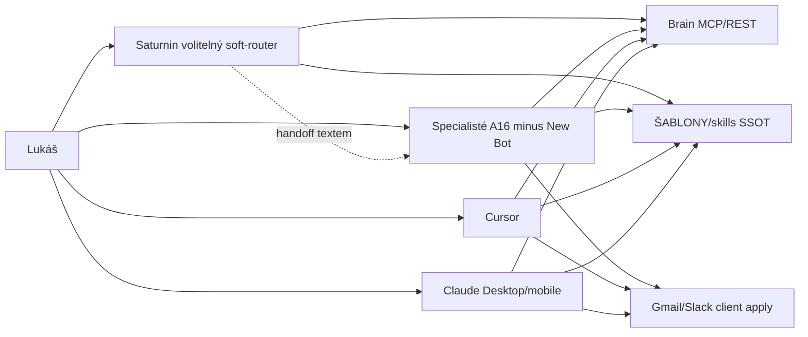

# Plán: F5 — Revize botů (Saturnin + specialisti → Brain)

> Architekt: **k=2 · r=1** (otevření #1; delta po critic kolo 2 — strop r=3 u k=1) · grill g=1 HOTOVÝ (A# beze změny, skip re-grill)
> Stav: DONE (2026-10-11)
> Pipeline ledger: [2026-10-10-sb-operacni-model-f5.pipeline.md](2026-10-10-sb-operacni-model-f5.pipeline.md)
> Parent F0 (SCHVÁLENO): [2026-10-10-sb-operacni-model-f0.md](2026-10-10-sb-operacni-model-f0.md) · F1–F4 DONE (F4 tip `34b1830` / close `80403c6`)
> Vault: **SB15 — Nový operační model SB** (**SB15-6** F5 — ladění botů)
> Profil: **SECOND_BRAIN**. Base (origin/main před pipeline): `80403c65803d20971f35aee00abf766fe39e5230`.
> Schvalování plánu uživatelem: **ne**. TESTER: přeskočeno (profil SECOND_BRAIN).

## Zadání a požadavky

R1 — Po F4 DONE spustit F5 pipeline (uživatel: „ok, pusť se do F5“; kotva **SB15-6**).

R2 — Scope F5 z F0 tabulky F5: vstupy = stabilní F2–F4; výstupy = Saturnin + specialisti na brain tools; úklid New Bot / případné sloučení. (F0 L325–331)

R3 — Pokryté F0 R#: **R3** (Grok styl: subagentí, proaktivita, computer use, paměť, mobil; CU jen Claude/Grok Desktop; Brain bez UI automace), **R17** (boti ladit v F5). (F0 + brief)

R4 — **R2 / A13 / B13 F0:** vůči Brain API jsou Cursor / Claude / Grok **rovnocenní**; Saturnin **není** povinná brána. Uživatel smí jít přímo na specialistu, Cursor nebo Claude. (F0 R2, Q15a)

R5 — Seznam botů = F0 **A16**: Saturnin, Second Brain, Inbox Manager, Správce kalendáře, Správce Wiki, Vládce RB Universe, Admin asistent, Právník, New Bot. (F0 A16; analýza „Boti dnes“)

R6 — **New Bot** = prázdný → **smazat** (ne sloučit do Saturnina). (analýza L91; výchozí A5)

R7 — Žádné sloučení specialistů v F5 DONE, kromě smazání New Bot — pokud grill neřekne jinak. (výchozí A6; grill Q1)

R8 — Boti se vaultem / mailboxem: (a) primárně Brain MCP/REST; (b) skilly ze SSOT `ŠABLONY/skills/`; (c) navenek propose→approve→client apply; (d) CU jen Desktop. **Domain boti** (Wiki, Universe, Admin, Právník) = doménové MCP (+ CU kde dává smysl); Brain jen když sahají do vaultu — matice s „—“ u Brain tools je OK. (R3, A12)

R9 — Přepsat multi-klient návody z Drive/FS éry na Brain-first (agent-guide, cowork-instructions, claude-project-instructions, morning brief, mrluc-loader odkazy). `agent_write_guard` zůstává v kódu jako legacy disk fail-path; **není** primární cesta. (F0 odchylka „návod+guard ≠ cíl“; F0 R23)

R10 — **F5 nemění:** F4 dump off (`SLACK_POLL_DUMP=0` / live L1), vault git SSOT, skills doménovou logiku (SSOT zůstává `ŠABLONY/skills/`), hub lifecycle crony, Brain tool surface (žádné nové MCP tools v F5 DONE), OAuth Brain apply post-F3 dluh. (brief)

R11 — Schvalování plánu: **ne**. Po QA: odškrtnout **SB15-6**. TESTER přeskočen.

R12 — Gate: `python3 -m pytest vps/second-brain-hub/tests scripts/tests vps/second-brain-brain/tests -q`. Deploy Coolify jen pokud diff sahá na `vps/` (výchozí F5 = **ne**).

**Mimo rozsah:** nová Brain tools; OAuth Brain apply; bulk FM wikilinky→ID/slug (F0 krok 10); obnovení n8n INBOX writers; anomaly proaktivita; hard GitHub ruleset A17 Pro; smazání `DriveVault` / `agent_write_guard` kódu; Universe FE; Claude artifact Desktop re-QA (F4 výhrada B12/B13 — ortogonální).

**Netýká se:** Alembic, RBAC Universe, subnav/hub dlaždice, `qa_gate.mjs`, Playwright-T6 / `rbu-tester`, Celery, Universe SQL P.

## Předpoklady

A1 — F2–F4 live: Brain `https://brain.cyprovi.cz`, MCP write Cursor+Claude+Grok ověřen (F2 create_task smoke), F3 live triage + propose, F4 dump off + light context.

A2 — Instrukce Grok botů žijí **v Grok UI** (ne v gitu). Analýza cituje `boti-prehled.md`, ale v tooling/vault **soubor chybí** (ověřeno: grep/glob 0 hitů mimo citaci). F5-a = export/recreate SSOT v vaultu + paste do Grok.

A3 — Cowork/Claude instrukce v tooling: `cowork-instructions.md`, `docs/claude-project-instructions.md`, `ŠABLONY/cowork-morning-brief.md`; vault: `OBSIDIAN/00-System/agent-guide-mimo-cursor.md` (gitignored).

A4 — Po F2 R6 smí Grok/Claude **`create_task` přes Brain MCP** — starý zákaz „jen daily + Cursor zakládá ID“ v agent-guide je **superseded** pro vault write path. Daily capture zůstává pro rychlé poznámky (`capture_daily`).

A5 — New Bot smazat (R6).

A6 — Specialisty neslučovat (R7), dokud grill neřekne jinak.

A7 — Saturnin = volitelný soft-router (handoff textem / odkazem na specialistu), ne proxy layer v Brain API.

A8 — `agent_write_guard` + T10–T12 pytest zůstanou; guide text se rozšíří o Brain-first a legacy sekci, reason kódy v guide zůstanou (T10 nesmí spadnout).

A9 — Diff F5 typicky jen `docs/`, `cowork-instructions.md`, `ŠABLONY/`, případně loader; vault materiály mimo git. Coolify redeploy **není** nutný.

A10 — Computer use zůstává mimo Brain (Allfred UI, banka, …) — jen Desktop boti; F5 jen dokumentuje hranici.

A11 — Reminder + meeting-prep: **stejný Grok Bot = Saturnin**, ale **dvě služby / dvě env** (grill Q2; critic NEW-1/NEW-6):
- **Hub** (`reminder_chat_delivery.py`): `GROK_BOT_REMINDER_WEBHOOK_URL` (+ token) → Saturnin
- **Brain** (`prepare_meeting._send_grok`): `GROK_BOT_MEETING_PREP_WEBHOOK_URL` (+ token) → Saturnin  
Správce kalendáře = ad-hoc chat / `prepare_meeting` (MCP), ne cron inbox — cron prep inbound = Saturnin přes Brain meeting-prep webhook.

A12 — Domain boti (Wiki / Universe / Admin / Právník): Brain-first neznamená „vše přes Brain“ — doménové MCP; Brain jen vault. (grill)

A13 — B3: Saturnin při „udělej triage“ **preferuje handoff** na Inbox Manager; sám jen když uživatel trvá ve stejném chatu. Nesmí být povinný vstup ke specialistovi (B2). (grill)

A14 — F5 DONE = F5-a…d včetně F5-c (Grok UI: smazat New Bot, paste, smoke T2–T4) **+ T12** (hub+Brain webhook → Saturnin). **SB15-6** až po T4 a T12. (grill + NEW-6)

A15 — Claude artifact Desktop = mimo F5 (F4 výhrada B12/B13). (grill)

## Současný stav (ověřeno v kódu / docs)

| Fakt | Důkaz |
|---|---|
| F0 F5 výstup | `docs/plans/2026-10-10-sb-operacni-model-f0.md` L325–331, B13 L378 |
| A16 seznam | F0 A16 L109; analýza L79–91 |
| New Bot = prázdný kandidát smazání | analýza L91 |
| Saturnin ≠ povinná brána | F0 R2 L15, A13 L103, Q15a |
| Brain MCP tools | `vps/second-brain-brain/app/mcp_app.py` L52–204 |
| Plugin manifesty Cursor/Claude/Grok → Brain | `ŠABLONY/plugins/README.md`; `ŠABLONY/plugins/grok/mcp.json.example` |
| agent-guide stále Drive/FS | `OBSIDIAN/00-System/agent-guide-mimo-cursor.md` |
| cowork / claude-project / morning brief drift | viz F5-b tabulka |
| Skills F3/F4 už Brain-first (triage, co-ted, reply) | `ŠABLONY/skills/agenda-*/SKILL.md` |
| Pytest T10–T12 guide/cowork/morning | `scripts/tests/test_agent_write_guard.py` |
| `boti-prehled.md` v repu/vaultu **není** | glob/grep 0 (mimo citaci v analýze) |
| SB15-6 otevřený checkbox | vault task SB15 |

### Mapa: kde dnes žijí instrukce

| # | Actor | Kde žije text | Jak volá data dnes (drift) |
|---|---|---|---|
| G1 | Grok Boti (A16) | Grok UI (mimo git) | Plugin MCP Brain (F2) + staré FS/Drive návyky z guide paste |
| G2 | Claude Cowork | `cowork-instructions.md` + folder | loader + guide (FS) + skills |
| G3 | Claude Project | `docs/claude-project-instructions.md` | Knowledge pin; částečně Brain |
| G4 | Grok paste block | agent-guide | FS režimy disk/schedule/remote |
| G5 | Cursor | `.cursor/rules` + skills | Brain MCP + lokální tooling |

## Návrh

### 0) Cílová topologie (R4, R8)

Saturnin **nefiltruje** přístup k Brain — jen pomáhá vybrat specialistu / skill.

### 1) SSOT inventář botů (R5, R6) — F5-a

| Soubor | Co | R# |
|---|---|---|
| `OBSIDIAN/02-PROJEKTY/second-brain/materials/2026-10-11 — boti-prehled.md` (nový; `type: material`, `related_tasks: [[SB15 …]]`) | Tabulka A16: status (keep/delete), 1–2 věty scope, primární Brain tools, primární skills, CU ano/ne, Grok UI jméno | R5–R8 |
| Stejný materiál | Sekce „Paste do Grok“ = hotové instruction blocky ≤ ~2–4 KB / bot | R8 |

**Cílová matice (výchozí keep):**

| # | Bot | Status | Primární Brain tools | Primární skills / MCP | CU |
|---|---|---|---|---|---|
| 1 | Saturnin | keep — soft-router + **reminder i meeting-prep** webhook target (A11) | `get_context`, `get_triage_candidates`, `schedule_reminder` | mrluc-loader → agenda-*; handoff | Desktop ano |
| 2 | Second Brain | keep — vault ops | `get_context`, `read_file`, `list_dir`, `create_task`, `update_task`, `capture_daily`, `allocate_task_id` | agenda-capture, agenda-work, agenda-status-update, agenda-co-ted | ne nutně |
| 3 | Inbox Manager | keep — mailbox + Slack live | `get_triage_candidates`, `slack_live`, `mailbox_propose`, `external_propose` | agenda-triage, agenda-reply | ne |
| 4 | Správce kalendáře | keep — meeting prep | `prepare_meeting`, `get_meeting_prep` | agenda-meeting-prep | ne |
| 5 | Správce Wiki | keep — wiki.redbuttonedu.cz | (Brain vault jen pokud materiál ve vaultu) | wiki MCP `user-wiki` / skill wiki-* | ne |
| 6 | Vládce RB Universe | keep — prod data | — | `user-rb-universe` MCP; prod-only rule | ne |
| 7 | Admin asistent | keep — Fakturoid/doklady | — | Fakturoid MCP / Universe finance read | Desktop CU výjimečně |
| 8 | Právník | keep — smlouvy | `read_file` / materials | capture/analyze; bez tichého send | ne |
| 9 | New Bot | **delete** | — | — | — |

### 2) Přepis návodů Brain-first (R9) — F5-b

| Soubor | Změna | Proč |
|---|---|---|
| `OBSIDIAN/00-System/agent-guide-mimo-cursor.md` | **Přepsat TL;DR:** vault write = Brain MCP (`brain.cyprovi.cz`); Mac klon = fetch/pull read; FS overwrite / `agent_write_guard` = **legacy fail-path** jen když Brain down a Lukáš explicitně dovolí disk. Povolit `create_task`/`update_task` přes MCP. Slack L1 = live (ne dump). n8n INBOX writers off. Grok paste block aktualizovat. **Zachovat** výpis reason kódů (T10). | R8, R9, A4, A8 |
| `cowork-instructions.md` | Po loaderu: Brain MCP + guide; denní zápis přes `capture_daily` / MCP create; odkaz na boti-prehled. F4 dump off nechat. | R9 |
| `docs/claude-project-instructions.md` | Tři klienti rovnocenní vůči Brain; Cursor preferovaný pro git/deploy/pytest; Cowork smí vault mutate přes MCP; aktualizovat handoff + INBOX (daily+sembly). | R4, R9 |
| `ŠABLONY/cowork-morning-brief.md` | Schedule: **explicitní override** — ne „Follow agenda-co-ted“ light-primary; čti **lokální `agent-context.json` nebo MCP `get_context`**. Ne `GET /v1/context/light` (F4: light jen human OAuth → service 403). Light jen interaktivní. Zachovat no write / no Slack. (NEW-2, NEW-7) | R9 |
| `ŠABLONY/skills/mrluc-loader/SKILL.md` | Odstranit provozní závislost na Drive Desktop offline; F2+ = Brain write. | R9 |
| `docs/brain-api-runbook.md` | Sekce „F5 boti“: odkaz na boti-prehled; Saturnin ≠ brána; A11 = **hub** `GROK_BOT_REMINDER_WEBHOOK_URL` + **brain** `GROK_BOT_MEETING_PREP_WEBHOOK_URL` → Saturnin (dvě služby). | R8 |
| `docs/plans/2026-10-04-agent-guide-mimo-cursor.md` | 1 odstavec „superseded pro write path F5“. | R9 |

### 3) Grok UI apply (R5–R8) — F5-c (ruční)

1. Smazat **New Bot**.
2. Do každého keep bota vložit paste block z boti-prehled.
3. Ověřit plugin `second-brain-brain` na Botu.
4. Smoke: Saturnin `get_context`; Second Brain `capture_daily` nebo `list_dir`; Inbox Manager `get_triage_candidates` (0 mutate).
5. **T12 / B17:** ověřit Coolify env — **hub** `GROK_BOT_REMINDER_WEBHOOK_URL` a **brain** `GROK_BOT_MEETING_PREP_WEBHOOK_URL` obě míří na Saturnin (ne T2/T4 Grok smoke).

### 4) Co F5 **vědomě nemění** (R10)

- `vps/second-brain-hub` crontab / `SLACK_POLL_DUMP`
- Brain `mcp_app.py` tool sada
- Doménová těla `agenda-*` skills (kromě mrluc-loader pointerů)
- Git vault / Coolify volumes
- `scripts/lib/agent_write_guard.py` logika (jen docs demote)

### 5) Vault task — F5-d

Po QA PASS: **SB15-6** `[x]` + log řádek; `updated:`; `python3 scripts/build_agent_context.py`.

## Kontrakt chování (B#)

| B# | Vstup / stav | Očekávaný výsledek | R# | Test T# |
|---|---|---|---|---|
| B1 | Čtenář otevře boti-prehled | A16 komplet; New Bot = deleted; Saturnin ≠ povinná brána; matice tools/skills | R4–R7 | T1 |
| B2 | Uživatel mluví na specialistu přímo | Specialista volá Brain; nepožaduje Saturnin | R4 | T2 |
| B3 | Uživatel mluví na Saturnina „udělej triage“ | Preferuje **handoff** na Inbox Manager; sám jen na výslovné trvání; nesmí blokovat přímý přístup ke specialistovi | R4, R3, A13 | T2 |
| B4 | Second Brain vault write | `create_task` / `update_task` / `capture_daily` přes MCP; ne FS jako SSOT writer | R8, R9, A4 | T3 |
| B5 | Inbox Manager mailbox/Slack mutate | Jen propose → preview → approve → client apply; Brain apply 403/501 | R8, R10 | T2 |
| B6 | Správce kalendáře | `prepare_meeting` / SSOT Meeting-Preps; ne třetí brief | R8 | T2 |
| B7 | Vládce RB Universe | Jen prod Universe MCP; ne dev | R8 | T2 |
| B8 | Computer use požadavek | Jen Desktop Claude/Grok; Brain tools bez UI automace | R3 | T1 |
| B9 | New Bot v Grok UI po F5 | Neexistuje | R6 | T4 |
| B10 | agent-guide po F5 | Brain-first TL;DR; reason kódy stále přítomné | R9, A8 | T5 |
| B11 | cowork-instructions | Odkaz na guide + Brain/MCP; F4 dump off zachován (text: zákaz zápisu do `01-INBOX/slack/`) | R9 | T6 |
| B12 | morning schedule | Read-only: local JSON nebo MCP `get_context`; prompt **override** light z agenda-co-ted; 0 vault write; 0 Slack | R9 | T7 |
| B13 | claude-project-instructions | Klienti rovnocenní vůči Brain; Cursor pro git/deploy | R4, R9 | T8 |
| B14 | Diff F5 | Žádná změna dump-off / git vault SSOT / skill domény (kromě loader pointer) | R10 | T9 |
| B15 | Pytest suite | Gate zelená | R12 | T10 |
| B16 | SB15-6 | `[x]` po QA | R11 | T11 |
| B17 | Coolify/env po F5-c | Hub `GROK_BOT_REMINDER_WEBHOOK_URL` + Brain `GROK_BOT_MEETING_PREP_WEBHOOK_URL` → Saturnin | A11 | T12 |

## Výkonový rozpočet (P)

F5 **nepřidává** endpointy ani cron body. Boti jen volají existující Brain tools — platí F2/F4 rozpočty (get_context / light ≤256 KB; triage 1 invocace; Saturnin bez fan-out full get_context).

## Testy (T#)

| T# | Typ | Owner | Soubor / místo | B# |
|---|---|---|---|---|
| T1 | ruční | gate | boti-prehled kompletnost + CU věta | B1, B8 |
| T2 | ruční | gate | Grok: přímý specialista + Saturnin handoff; 0 mutate u triage smoke | B2, B3, B5–B7 |
| T3 | ruční / MCP smoke | gate | Second Brain: `get_context` + `capture_daily` nebo create TEST + cleanup Cancelled | B4 |
| T4 | ruční | gate + user | New Bot smazán v Grok UI | B9 |
| T5 | pytest | gate | `test_t10_guide_*` + assert Brain-first fráze v guide | B10 |
| T6 | pytest | gate | `test_t12_cowork_instructions_*`: Brain zmínka **+** assert dump-off / zákaz zápisu do `01-INBOX/slack` (NEW-3) | B11 |
| T7 | pytest | gate | `test_t11_morning_*`: assert fráze override (local JSON / `get_context`; ne Follow light z agenda-co-ted); 0 FS write / 0 Slack (NEW-2, NEW-7) | B12 |
| T8 | ruční / grep gate | gate | claude-project-instructions rovnocennost + Cursor git/deploy | B13 |
| T9 | ruční diff review | gate | `git diff` neobsahuje crontab dump / skill doménové regresy; **+** cowork/guide stále obsahují dump-off řádky (NEW-3) | B14 |
| T10 | pytest | gate | plný suite: `python3 -m pytest vps/second-brain-hub/tests scripts/tests vps/second-brain-brain/tests -q` (ne `test_t10_*`) | B15 |
| T11 | ruční vault | gate | **SB15-6** checkbox `[x]` (ne `test_t11_morning_*`) | B16 |
| T12 | ruční Coolify/env | gate | Důkaz: hub env `GROK_BOT_REMINDER_WEBHOOK_URL` + brain env `GROK_BOT_MEETING_PREP_WEBHOOK_URL` → Saturnin (NEW-6; ne Grok chat smoke) | B17 |

TESTER: přeskočeno (profil SECOND_BRAIN).

## Pořadí implementace

- **F5-a** — materiál `boti-prehled.md` + paste blocky.
- **F5-b** — přepis guide + cowork + claude-project + morning + mrluc-loader + runbook; upravit pytest T5–T7.
- **F5-c** — aplikace do Grok UI (smazání New Bot, paste, plugin check, T2–T4) + **T12** hub/Brain webhook env.
- **F5-d** — pytest T10; diff review T9; SB15-6 `[x]`; ledger DONE.

Závislosti: F5-a před F5-c; F5-b může paralelně s F5-a; Coolify ne.

## Rizika a zpětná kompatibilita

1. **Grok UI mimo git** — drift instrukcí; mitigace boti-prehled SSOT + T2/T4.
2. **Dvojí pravda guide vs skills** — „skill = postup; write path = Brain“ v guide.
3. **Uživatel zvyklý na FS write** — legacy sekce v guide; default deny tichý FS.
4. **Reminder / meeting-prep webhook na špatném Botu** — A11 hub vs Brain + F5-c.5 + T12/B17.
5. **Saturnin jako skrytá brána** v copy — B2/B3.
6. **Service Bearer vs human OAuth light** — schedule nesmí light-first (NEW-2); light jen interaktivní OAuth; runbook.
7. **T10 křehkost** při mazání reason kódů — A8 zakazuje.
8. **Scope creep** nové Brain tools — mimo F5 (R10).

## Otevřené otázky pro grill

*(g=1 HOTOVÝ — Q1–Q3 + A12–A15 defaulty. Schvalování plánu: ne.)*

Žádné blokující.
