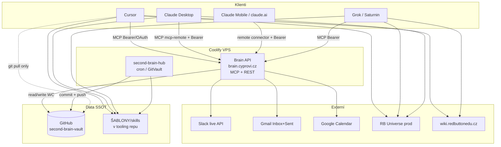
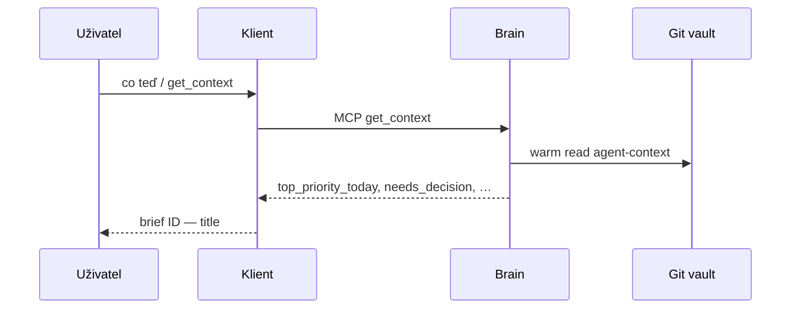
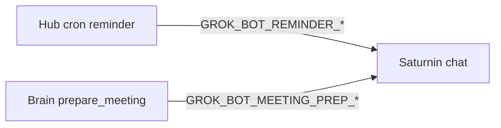

# Second Brain — architektura (přehled pro schémata)

> **Účel:** jeden dokument, ze kterého jde vygenerovat zjednodušené schéma propojení (klienti ↔ Brain ↔ git ↔ cron ↔ Slack/Gmail).  
> **Stav:** po F0–F5 (2026-10-11). Detail fází = `docs/plans/2026-10-10-sb-operacni-model-f*.md`.  
> **Kopiе ve vaultu:** `OBSIDIAN/02-PROJEKTY/second-brain/materials/2026-10-11 — Architektura Second Brain.md`

## 1) Dva GitHub repozitáře

| Repo | Role |
|---|---|
| [`LC-RBEDU/second-brain`](https://github.com/LC-RBEDU/second-brain) | **Tooling** — `vps/`, `scripts/`, `ŠABLONY/skills`, plány, runbooky |
| [`LC-RBEDU/second-brain-vault`](https://github.com/LC-RBEDU/second-brain-vault) | **Vault SSOT** — úkoly, materiály, INBOX, Areas (privátní) |

Lokální Drive složka `…/SECOND_BRAIN/OBSIDIAN/` je pracovní pohled / mirror; **SSOT zápisu** = git vault přes VPS `GitVault` + Brain API, ne Drive dual-writer.

## 2) Celkové propojení (mermaid)



## 3) Zapisovatelé vs čtenáři vaultu

| Kdo | Vault | Poznámka |
|---|---|---|
| Coolify hub (cron) | **write** (GitVault + push) | lifecycle, `agent-context.json`, reminders, meeting-prep, … |
| Brain API | **write** (sdílený WC) | MCP tools: tasky, daily, reminders, … |
| Cursor / Mac klon | **read** (git pull) | ne `git push` z Macu jako SSOT |
| Claude / Grok | **write jen přes Brain MCP** | ne FS overwrite jako hlavní cesta |
| Obsidian Sync / Drive writer | **off** | Drive jen R9 (Docs/Sheets/shared/large) |
| n8n → INBOX dump | **off** | F1+; Slack dump cron F4 off |

## 4) Klienti (po F5)

| Klient | Jak volá Brain | UX poznámka |
|---|---|---|
| Cursor | native MCP `second-brain-brain` | preferovaný pro git/deploy/pytest |
| Claude Desktop | `mcp-remote` → `https://brain.cyprovi.cz/mcp/` | Project Instructions + MCP |
| Claude Mobile / claude.ai | remote Custom Connector + header `Authorization: Bearer …` | stejný účet; ne lokální `lcl-` bridge |
| Grok Saturnin | MCP plugin + Bearer | Lukáš mluví primárně se Saturninem; specialisti přes něj |
| Grok specialisti | stejný účetní MCP | Second Brain, Inbox Manager, kalendář, wiki, Universe, Admin, Právník |

Saturnin **není** technická brána k Brainu (Cursor/Claude smí Brain napřímo). V Grok UI je soft-router.

Inventář botů: vault `materials/2026-10-11 — boti-prehled.md`.

## 5) Datový model (vault)

```
00-System/          agent-context.json, guide, Memory, Reminders-Pending, Meeting-Preps
01-INBOX/           daily, sembly (slack dump off — live L1)
02-PROJEKTY/        <Hub>.md + <slug>/tasks/ + materials/
03-AREAS/
05-RESOURCES/       lide/, vystupy/, …
07-ARCHIV/
```

- **Task** = jeden `.md` + YAML (`status`, `focus`, `deadline` / `review_deadline`, ICE, …)
- **Hub** = charter projektu + Bases
- **Hierarchie** (vybrané projekty): epic → story; listové kroky = checkboxy `**ID-N**`
- **Snapshot priorit** = `00-System/agent-context.json` (+ light projekce pro dashboard)

## 6) Brain API (veřejné HTTPS)

| Povrch | URL / cesta |
|---|---|
| MCP | `https://brain.cyprovi.cz/mcp/` |
| REST kontext | `GET /v1/context`, `GET /v1/context/light` (light = **human OAuth only**) |
| Triáž | `GET /v1/triage/candidates`, `GET /v1/slack/live` |
| Mailbox / Slack mutate | propose → approve → **client apply** (Brain apply 403/501) |
| Meeting prep | `prepare_meeting` / `get_meeting_prep` |
| OAuth člověk | `/oauth/authorize` → cookie session |
| Service | `Authorization: Bearer BRAIN_SERVICE_TOKEN` |

Runbook: [`docs/brain-api-runbook.md`](brain-api-runbook.md).

## 7) Hub cron (deterministika, ne LLM)

Typicky na Coolify `second-brain-hub` (supercronic): lifecycle Done/Waiting/archiv, hub `## Stav (auto)`, `build_agent_context` (workhours), reminders dispatch → Grok webhook (**Saturnin**), meeting-prep window → Brain deliver → **Saturnin**, proaktivita (ráno / due / večer).

**Vypnuto:** `slack_poll` dump do `01-INBOX/slack/` (`SLACK_POLL_DUMP=0`).

## 8) Klíčové toky (zjednodušeně)

### 8.1 Priorita / „co teď“



### 8.2 Zápis úkolu

Klient → Brain `create_task` / `update_task` / `capture_daily` → GitVault commit/push → GitHub vault.

### 8.3 Triáž Slack/Gmail

Live L1 (`get_triage_candidates` / `slack_live`) → návrh v chatu → schválení → client apply (Gmail/Slack). Žádný tichý send/trash.

### 8.4 Připomínka / meeting-prep



Obě URL → stejný Grok Bot **Saturnin**. Paralelní Grok rutina „příprava před schůzkou“ = vypnutá (duplicita).

## 9) Skills a pluginy

- SSOT postupů: `ŠABLONY/skills/<name>/SKILL.md` (tooling repo)
- Manifesty MCP: `ŠABLONY/plugins/{cursor,claude,grok}/`
- Loader: `mrluc-loader` → matching agenda-*

## 10) Co úmyslně není

| Položka | Stav |
|---|---|
| VPS web dashboard | ne — F0/F4 |
| Claude artifact | optional vizuál v Claudu + light OAuth; ne „odkudkoliv“ bez Clauda |
| Dev Universe jako SSOT firemních dat | ne |
| Saturnin povinný pro Cursor/Claude | ne |
| Drive jako vault writer | ne (jen R9) |

## 11) Odkazy na detail

| Téma | Dokument |
|---|---|
| Cílová architektura F0 | `docs/plans/2026-10-10-sb-operacni-model-f0.md` |
| F1–F5 plány | `docs/plans/2026-10-10-sb-operacni-model-f1.md` … `f5.md` |
| Sync / GitVault | `vps/second-brain-hub/docs/sync-architecture.md` |
| Git vault ops | `docs/git-vault-runbook.md` |
| Brain ops | `docs/brain-api-runbook.md` |
| Claude Project text | `docs/claude-project-instructions.md` |
| Boti paste | vault `…/materials/2026-10-11 — boti-prehled.md` |
| Hub deploy | `vps/second-brain-hub/README.md` |
| Brain deploy | `vps/second-brain-brain/README.md` |

---

*Pro generování schématu: použij sekce 2, 3, 4, 7 a 8; drž se tabulek writer/reader a mermaid bloků.*
