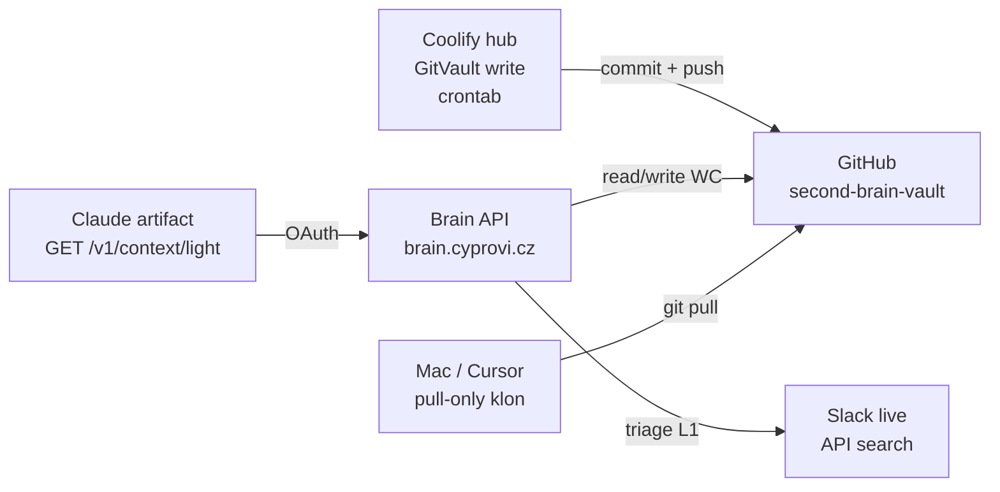

# Sync architecture — vault SSOT (F4)

> **F4 (2026-10):** SSOT = privátní GitHub vault + `VAULT_BACKEND=git` + `GitVault` + Brain API.  
> Drive = jen **R9** výjimky (native Docs/Sheets, shared, >40 MiB). Obsidian = volitelný pull-only.  
> Runbooky: [docs/git-vault-runbook.md](../../../docs/git-vault-runbook.md), [docs/brain-api-runbook.md](../../../docs/brain-api-runbook.md).  
> Legacy Drive plán: [sync-implementation-plan.md](./sync-implementation-plan.md) (historický).

## Cílový tok

## Zapisovatelé / čtenáři

| Role | Backend | Poznámka |
|---|---|---|
| Coolify `second-brain-hub` | GitVault | Cron (context, lifecycle, …). **`slack_poll` dump = F4 off** |
| Brain | GitVault shared WC | Mutate OAuth/service dle tool; light = human OAuth only |
| Cursor / Mac | git pull | **Žádný** lokální zápis do klonu jako SSOT writer |
| Obsidian | optional pull-only | Sync/Drive dual-writer **off** |
| Drive | R9 only | Docs/Sheets/shared/large — ne vault dump |

## Slack po F4

- **Ne** cron dump do `01-INBOX/slack/`.
- Triáž L1 = Brain `slack_live` / `get_triage_candidates` (live search: DM/GDM, mentions, `:eyes:`, `:gear:`).
- Residual dump → one-shot `cron/archive_slack_inbox.py` → `07-ARCHIV/inbox-processed/`.

## Drive R9 (co smí zůstat mimo git vault)

- Google Docs / Sheets / native formáty
- Sdílené složky mimo osobní vault
- Soubory > ~40 MiB (git limit prakticky)
- Vše ostatní pracovní = `materials/` / sidecar v gitu

## Legacy

Původní Drive mermaid a Obsidian Sync dual-writer jsou **historie** (pre-F1/F4). Neprovozovat `VAULT_BACKEND=drive` pro hub cron.
